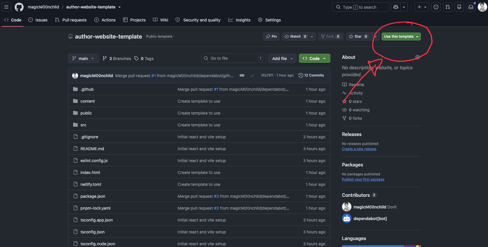
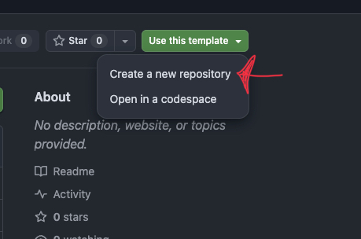
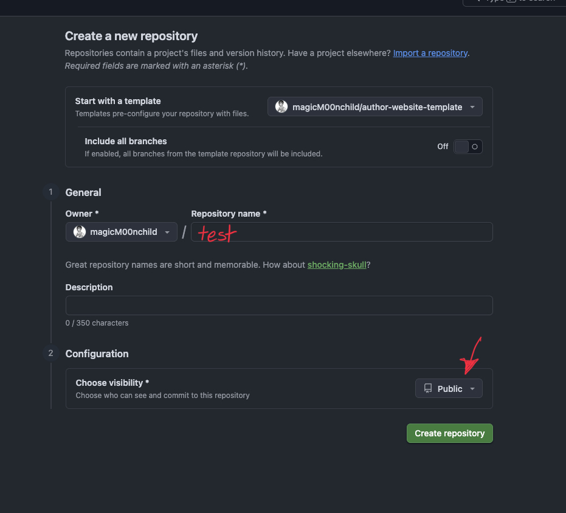
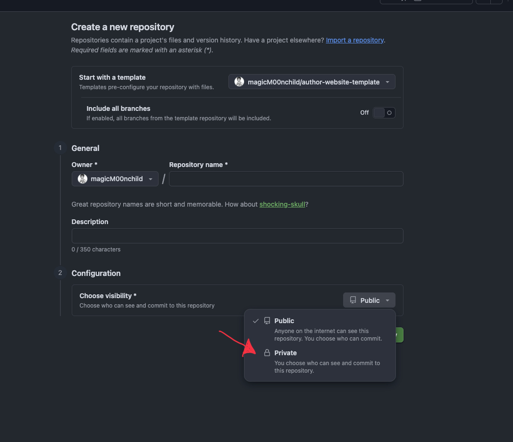
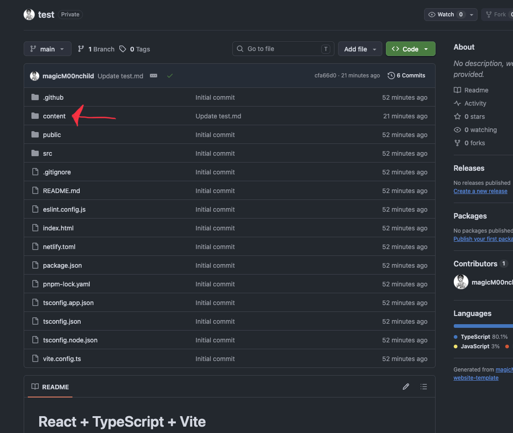

# Fanfiction Website Template

A customizable, lightweight website template for fanfiction authors. 
Since AO3 is gonna be down this might be a solution without using any drives. 

## Features

- **Fanfiction overview** – Display all your published stories.
- **Story details** – Show story descriptions, metadata, tags and statistics.
- **Chapter navigation** – Navigate between chapters using previous/next links or the chapter selector.
- **Customizable configuration** – Manage your author information and social media links in one Markdown file.
- **Privacy and contact pages** – Includes customizable contact and privacy policy pages.
- **Responsive design** – Designed to work on desktop and mobile devices.

## Tech Stack

- React
- TypeScript
- Vite
- React Router
- CSS

## Getting Started Using GitHub Webview

### Requirements

- github account https://github.com/

### Step 1: Use the template to create your own repository



### Step 2: Create your own Repository 



### Step 3: Fill out the creation template.
You need a name. That name will only be visible for you. 
At the bottom of the page click the visability option 



### Step 4: Make your repository private



### Step 5: Go to your own repository and click on the content folder



### Step 6: Create your fanfictions 
Fill out the site-config.md with the necessary informations. You are free to link your social media accounts here. Currently we are supporting; instagram, tumblr, tiktok, x, bluesky

Once you have finished all your changes click the button on the top right and just follow the pop up dialog as shown. 


You can add your fanfictiuons in the fanfiction folder. Please make sure to follow the fanfiction-template. Simply copy everything from the template and paste it in a new file. 
The editing process is the same as for the site-config.md 

There is a markdown-formating.md file to help with some formating :)


Now you are set to type out all you want. 


## Set Up your own website 


Yay! You did it! 


## Getting Started Using Local Development Tools

#### Requirements

- Node.js (LTS recommended)
- npm

#### Installation

Clone the repository:

```bash
git clone https://github.com/YOUR_USERNAME/YOUR_REPOSITORY.git
```

Navigate into the project folder:

```bash
cd YOUR_REPOSITORY
```

Install dependencies:

```bash
npm install
```

Start the development server:

```bash
npm run dev
```

The website will be available at the local URL displayed in your terminal.

## Customization

### 1. Website Configuration

Open `content/site-config.md` and customize your website information:

```md
---
author: "Jane Doe"
title: "Jane's Fanfiction"
description: "A collection of my fanfiction stories."

instagram: "https://instagram.com/username"
tumblr: ""
tiktok: ""
---
```

You can change your author name, website title, description and social media links here.

### 2. Adding Fanfiction

Create a new Markdown file inside:

```text
content/fanfictions/
```

For example: `my-first-story.md`

Use the following structure:

```md
---
title: "My First Fanfiction"
author: "Jane Doe"
description: "A story about two lost souls."
fandom: "Supernatural"
rating: "Mature"
warning: "Graphic Depictions Of Violence"
category: "M/M"
relationship: "Castiel/Dean"
language: "English"
tags: Romance, Angst, Fluff
published: "2026-01-01"
words: "1500"
chapters: "2/2"
comments: "0"
kudos: "0"
bookmarks: "0"
hits: "0"
---

<!-- chapter -->

# Chapter 1: The Beginning

Your story starts here.

<!-- chapter -->

# Chapter 2: The Journey

Continue your story here.
```

Each `<!-- chapter -->` marker separates one chapter from the next.

### 3. Contact and Privacy

The contact page uses the social media links configured in `site-config.md`.

The privacy policy is included as a starting point. Please review and adapt it to your actual hosting provider and website features before publishing.

## Building for Production

To create a production build:

```bash
npm run build
```

The generated files will be available in the `dist/` directory.

You can deploy the website using static hosting providers such as Netlify or GitHub Pages, provided the hosting configuration supports your routing setup.

## License

This project is licensed under the MIT License. See the `LICENSE` file for details.

## Contributions

Suggestions, bug reports and improvements are welcome! Feel free to open an issue or submit a pull request.